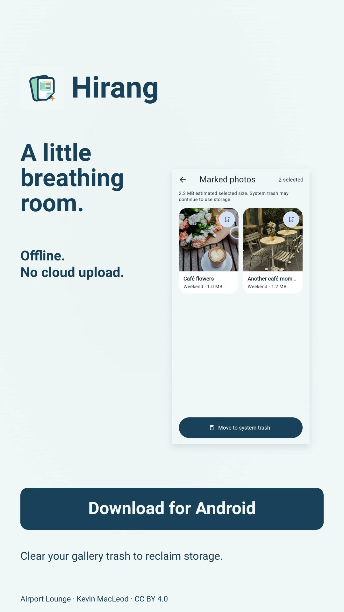

# Hirang

An Android photo cleaner that keeps review decisions on your device. Swipe left to mark, right to keep, undo, review the marked set, then request recoverable system trash after confirming in Hirang and approving Android's prompt.

The current local install build is [Hirang APK](build/app/outputs/flutter-apk/hirang-1.0.4-photo-loading.apk), version **1.0.4 (5)**. It is an ARM64 release build signed with the same existing local development key as the previous build. The package version was not bumped. The historical [1.0.4 themes APK](build/app/outputs/flutter-apk/hirang-1.0.4-themes.apk) remains preserved separately. No store signing credentials or publication were created.

## Watch the ad

**Breathing room** · 24 seconds

[Watch or download the ad (MP4)](https://raw.githubusercontent.com/FrancisGiann/Hirang-Swipe-Photo-Cleaner/main/docs/media/ads/Hirang-Breathing-Room.mp4) · [View file on GitHub](docs/media/ads/Hirang-Breathing-Room.mp4) · [Caption and credits](docs/media/ads/Hirang-Breathing-Room-caption.txt)

Actual app widgets show Keep, Mark, marked review and app confirmation using licensed stock photos and staged records. Marking alone does not free storage; clearing system trash in your gallery reclaims space.

Music: [Airport Lounge](https://incompetech.com/music/royalty-free/index.html?Search=Search&isrc=USUAN1100806) by Kevin MacLeod ([incompetech.com](https://incompetech.com/)), [CC BY 4.0](https://creativecommons.org/licenses/by/4.0/). Trimmed, normalized, faded and mixed. Full credits are linked above.

Photos by [Burcufilms](https://www.pexels.com/photo/overhead-shot-of-a-table-with-a-bouquet-of-flowers-and-cups-of-coffee-14838543/), [Esra Nur Kalay](https://www.pexels.com/photo/close-up-of-coffee-and-bouquet-of-flowers-15278356/) and [Eugenia Remark](https://www.pexels.com/photo/bottles-of-flowers-on-cafe-tables-26268972/) via Pexels, under the [Pexels License](https://www.pexels.com/license/). No endorsement is implied.

## Install or update on your phone

1. Connect the unlocked phone to this computer by USB and select **File Transfer** on the phone. See [Android's USB transfer guide](https://support.google.com/android/answer/9064445?hl=en).
2. Copy [Hirang APK](build/app/outputs/flutter-apk/hirang-1.0.4-photo-loading.apk) to the phone's **Download** folder using the computer's file manager.
3. Open that APK in the phone's file manager, follow Android's installation prompts, and tap **Install** or **Update**. Updating the existing Hirang installation uses the same package and signing key; do not uninstall it first if you want to retain local review progress.
4. Open **Hirang**. The first-launch introduction explains the flow and includes a generated practice card. Choose **Try the sample deck** to try it without photo access, **Choose photos** to request access, or **Not now**. The introduction can be skipped and replayed from **Photo options**.

Android 11/API 30 or later is required. This APK targets ARM64 phones, including the intended POCO M7 Pro 5G.

## Everyday use

- While holding a drag, a green **KEEP** indicator appears for rightward intent or a red **MARK FOR REMOVAL** indicator appears for leftward intent, with a matching icon. It strengthens toward the release threshold and updates as you reverse direction. No decision is made while holding; a short release or cancelled drag returns the card without changing progress.
- Swipe or use **Mark**/**Keep**, and use **Undo**, including after the last card. Review progress is saved across sessions. Marking only changes the local review decision.
- Photo cards show a cached preview while higher detail loads for their actual size and pixel density, then replace it when the detailed image is decoded and ready. Open **Photo details → View photo larger** for the expanded preview. Failed detail requests keep the preview and offer **Retry**; reduced-provider or unreadable detail is labeled **Preview only** and can be retried. A swipe never leaves the previous photo on screen.
- Open the scrollable **Filters** sheet for month, album, or screenshots. Counts describe the accessible subset. A saved filter that becomes unavailable remains visible and can be reset.
- Open **Marked** to inspect and unmark photos. **Estimated selected size** distinguishes unknown sizes; system trash can continue using storage.
- **Move to system trash** checks one fixed selection, presents app confirmation, then **Review system confirmation** opens Android's approval. Photos are not moved to trash until system approval. Changed selections require a new confirmation. Cancelled, partial, missing, or ambiguous outcomes remain distinct from verified trash.
- **Photo options → Settings → Appearance → Theme** offers Amihan (cool ivory/deep blue), Dapithapon (warm cream/terracotta), and Hatinggabi (charcoal/lavender). The choice is saved locally and switches immediately without resetting review progress. Green Keep and red Mark keep their meaning; photo colors are unchanged.
- **Photo options** provides photo-access management, refresh, Android app settings, help, and introduction replay. Limited access, empty libraries, query failures, and saved-state recovery have explicit next actions.
- An exact restored identity can return to review. Old result replay preserves later Keep/Mark decisions. Recovery itself belongs to the gallery/provider; in-app Undo only reverses review decisions before a trash request.

The app has no account, uploads, backend, telemetry, internet permission, or permanent-delete path. It stores no photo copies on disk and excludes local state from Android backup. Local cleaning does not guarantee anything about a separate cloud backup or immediate storage reclamation.

## Photo clarity

The old path enlarged provider thumbnails capped at 768 pixels and recompressed them as JPEG quality 82. The active card and expanded view now decode the source on a worker at the measured viewport size, preserving aspect ratio and Android's orientation handling. Each decode is capped at a 2048-pixel edge and 3 million pixels. Lossless WebP is used first, with the existing bounded lossy WebP quality-95 fallback; original media is never rewritten.

The grid and the next two eligible card thumbnails remain at 512 pixels. Hirang also prefetches detail for one upcoming card using the currently measured viewport/DPR size. It warms the same in-memory decoded image used by the visible card, while keeping visible work and grid loading ahead of speculation. Both encoded and decoded image caches are bounded; no photo copies are stored on disk. The app cannot add detail absent from the original.

In the current card, the cached preview stays visible under a small loading indicator until the detailed image's first Flutter frame is ready. If source detail is unavailable, the decoded preview remains visible with a **Preview only** label and a retry action. Generated fine print and checker patterns were inspected in 1080 × 2400 card and viewer renders; these are fixture-based Flutter renders, not measurements from a phone. Native provider/codec latency and device frame pacing remain unmeasured.

In debug and profile builds, generic timing spans are available for `Hirang.photo.queue`, `Hirang.photo.source_decode`, `Hirang.photo.preview_decode`, and `Hirang.photo.encode`. Flutter DevTools also shows `Hirang photo queue wait` (with a `queue_ms` argument) and `Hirang photo Flutter frame ready`. Release builds disable these spans. To compare cold and warm behavior on a connected phone, run the app in profile mode, capture an Android Studio System Trace/Perfetto trace and Flutter DevTools timeline, open a card that has not been prefetched, then swipe to its prefetched next card in the same process. Compare time from swipe to the Flutter frame-ready span and the queue/decode/encode durations. The trace labels contain no photo IDs, URIs, or image data. No phone was connected for this build's checks, so no device timings are reported.

The independently verified clarity milestone is preserved as [Hirang 1.0.3 (4)](build/app/outputs/flutter-apk/hirang-1.0.3-photo-clarity.apk). Its SHA-256 is `1ceab400ae0080306130447ce5c2d055e29fae2c8d812e8b92f84d84f40df561`. The historical 1.0.4 themes APK is also preserved separately; the current build includes both milestones.

## Engineering checks

Verified on 10 October 2026 with the existing Flutter 3.47.2, Temurin JDK 21, and Android NDK 28.2.13676358:

- Theme migration, restart persistence, failed saves, serialized review/theme writes, live switching, narrow large text, reduced motion and representative token contrast are checked. These checks target text contrast of 4.5:1 and control/icon contrast of 3:1; they are not a complete accessibility audit.
- The earlier themes milestone recorded **60 passing Flutter tests** and **19 native JVM tests**. The current photo-loading build passes **69 Flutter tests** and all **19 native JVM tests**. `flutter analyze lib test` reports no issues. Whole-project `flutter analyze` still reports three existing diagnostics in the generated `brag-output/work/flutter_capture_harness_test.dart`: unnecessary imports at lines 1 and 3, and an unused import at line 12; that unrelated file was left untouched.
- Kotlin compilation, ARM64 profile and release APK builds, and package/version/permission/signature inspection. The new release APK has the same signing-certificate SHA-256 as the preserved themes APK: `b33178ae6305c6776f3971fda246c7f4738200830e5ad1d1709983b3c855ab63`.
- **58 actual Flutter screen captures** plus round, squircle, and monochrome icon previews inspected. The screens use real app widgets, cached fonts, generated fixtures, light/dark themes, and selected large-text layouts. See [VISUAL_REVIEW.md](VISUAL_REVIEW.md) for the evidence and coverage limits.
- Compact review layout, full-height photo viewing, scrollable filters, balanced actions, consistent supporting states, first-launch practice, and an original photo/check launcher icon.

The current [photo-loading APK](build/app/outputs/flutter-apk/hirang-1.0.4-photo-loading.apk) is **17,916,884 bytes** with SHA-256 `fb79b04f86126b1a3aba8ee584468bd619075358080b9fd5d08bf05651f3078c`. Its manifest remains `com.francisgiann.hirang`, version **1.0.4 (5)**, ARM64. The historical [themes APK](build/app/outputs/flutter-apk/hirang-1.0.4-themes.apk) remains **17,851,348 bytes**, SHA-256 `eadecc13dbb9bb1658305aa32076e96998c0aa7c386f91d2354c6d68f7e8a926`.

Phone-specific permission dialogs, gallery trash/recovery behavior, TalkBack, and cold/warm frame pacing have not been measured on hardware; `adb devices -l` found no connected device. [PLAN.md](PLAN.md) records the platform boundaries and engineering follow-ups. No personal photo library was scanned or modified and no app was installed on a phone during these checks.

Duplicate detection, AI, cloud sync, monetization, videos, and iOS remain deferred.

Project directory: `/home/francisgiann/Giann/Programming/hirang`.
# Hirang-Swipe-Photo-Cleaner
